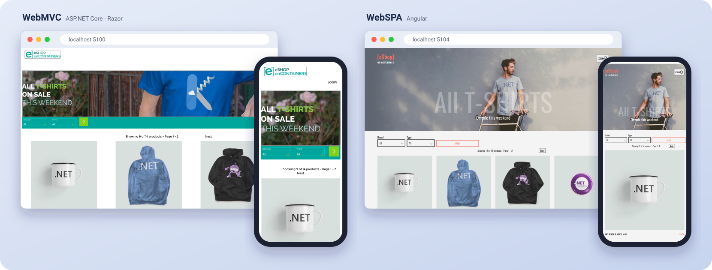

[](https://github.com/giis-uniovi/retorch-st-eShopContainers/actions)
[](https://sonarcloud.io/summary/new_code?id=my%3Aretorch-st-eShopContainers)

# RETORCH eShopContainers End-to-End Test Suite

This repository contains a detached fork of [eShopContainers](https://github.com/erjain/eShopOnContainers) and an
End-to-End Test suite that are used as demonstrator of the [RETORCH Framework](https://github.com/giis-uniovi/retorch).
eShopContainers is a sample reference application, powered by Microsoft, based on a simplified microservice architecture
using Docker containers. See more details in the [forked version](https://github.com/erjain/eShopOnContainers)
or the [official repository](https://github.com/dotnet-architecture/eShopOnContainers).

<p align="center">
  
</p>

## Prerequisites

- Java 8 or newer and Maven 3.8+ (to run the tests).
- Docker Engine / Docker Desktop `>= 26.0.0` with Docker Compose `>= 2.26.1`.
- Google Chrome (the UI tests drive a local Chrome through Selenium).
- Enough memory for the SUT: it starts many containers (SQL Server, RabbitMQ, Redis, Envoy gateways...).

## SUT deployment

### Local deployment

The SUT in the `📁 sut` directory is deployed with Docker Compose. The scripts in the root of the repository (`deploy.sh` for Linux / macOS and
`deploy.ps1` for Windows) tear down any previous local deployment, build the images (the Envoy gateways need the `TAG` substitution, so
they are always rebuilt) and start the containers with `.retorch/envfiles/local.env`, using the project name `local`.

| Linux / macOS | Windows (PowerShell) | What it does |
|---|---|---|
| `./deploy.sh` | `.\deploy.ps1` | Builds the images and deploys the SUT, then waits until it answers |
| `./deploy.sh --no-build` | `.\deploy.ps1 -NoBuild` | Same, reusing the images already built |
| `./deploy.sh --down` | `.\deploy.ps1 -Down` | Tears down the deployment |

(The first time on Linux / macOS: `chmod +x deploy.sh`.)

Once the SUT is ready (it can take a few minutes) it is available at:

| Service | URL |
|---|---|
| WebMVC | http://localhost:5100 |
| WebSPA | http://localhost:5104 |
| WebStatus | http://localhost:5107 |
| Identity | http://localhost:5105 |
| Seq (logs) | http://localhost:5340 |
| RabbitMQ | http://localhost:15672 (guest / guest) |
| SQL Server | `localhost:5433` (sa / Pass@word) |


### Jenkins CI deployment

The repository contains a `Jenkinsfile` and the lifecycle scripts in `.retorch/` that run the test suite in CI. They are
**generated** by the [RETORCH tool](https://github.com/giis-uniovi/retorch) from the `@AccessMode` annotations of the tests: do
not edit them by hand. After adding or changing tests, regenerate them with `orchestrate.ps1` (it needs the
`retorch-orchestration-*-standalone.jar` of the RETORCH tool in the repository root and Maven in the path).

- The pipeline runs on a Jenkins agent labelled `xretorch-agent` with Docker (Compose v2), Java and Maven.
- Every TJob deploys its **own** copy of the SUT (`--env-file .retorch/envfiles/<tjob>.env -p <tjob>`) on the external Docker
  network `jenkins_network`, runs the tests assigned to it (`mvn test -Dtest=... -DTJOB_NAME=<tjob> -DSUT_URL=<url>`) and
  tears the deployment down. TJobs of the same stage run in parallel.
- `.retorch/configurations/retorchCI.properties` holds the SUT particularities used by the generated scripts (how to wait for
  the SUT, where its sources are, its URL inside the Docker network). With `profiling=true` the pipeline also measures the
  CPU, memory and storage of every TJob and publishes the **usage profile** (`artifacts/usageprofile/usageprofile.html`, report
  "RETORCH Usage Profile"). The profiling tool is prepared by `.retorch/customscriptscode/custom-usageprofile` (it builds it from
  source, so the agent also needs Git); delete that file once a release publishes the jar.
- Custom commands of each lifecycle phase live in `.retorch/customscriptscode/`.

Particularities of this SUT:

- The SUT sources are in `sut/src` (`sut-location` in `retorchCI.properties`) and every TJob builds the two Envoy gateway images
  (`webshoppingapigw`, `mobileshoppingapigw`) before deploying (`custom-tjob-setup`).
- Because of the number of containers per TJob, Linux agents may run out of inotify instances. Increase them, e.g. in
  `/etc/sysctl.conf`:

```bash
fs.inotify.max_user_instances=2048
fs.inotify.max_user_watches=1048576
```

## Running the tests

With the SUT deployed (see [Local deployment](#local-deployment)) run the whole suite from the repository root:

```bash
mvn test
```

To run a single class or method:

```bash
mvn test -Dtest=<TestClass>
mvn test -Dtest="<TestClass>#<testMethod>"
```

Locally, **do not pass `-DSUT_URL`**: without it the tests use the `LOCALHOST_*` URLs of `src/test/resources/test.properties`
(WebMVC at http://localhost:5100). When `SUT_URL` is set (as the CI does) the API tests switch to the Docker-internal host names
of the TJob (`identity_api_<tjob>`...), which are not reachable from the host.

The CI pipeline also passes `-DTJOB_NAME=<tjob>` (the name of the TJob running the tests) together with `-DSUT_URL`.

The tests are grouped in `giis.eshopcontainers.e2e.functional.tests.webmvc`, `.webspa` and `.api` (for example
`mvn test -Dtest="giis.eshopcontainers.e2e.functional.tests.api.*"`). The users and the other URLs and ports used by the tests
are in `src/test/resources/test.properties`. Set `SELENOID_PRESENT` to run the browsers in a Selenoid / Selenium Grid instead of a
local Chrome (as the CI does).

---

<p align="center">
  <a href="https://giis.uniovi.es/"></a>
</p>
